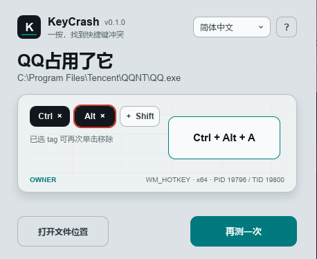

# KeyCrash

**Find out why your shortcut isn't working.**

[简体中文](README.md) · English · [日本語](README.ja.md)

KeyCrash checks for global hotkey registration conflicts and tries to identify the app using it.

For **Windows 10 / 11 (64-bit) and macOS**. Available in Chinese, English, and Japanese.

## Download and run

Download `keycrash-v<version>-windows-x64.zip` from [Releases](https://github.com/Yuelioi/keycrash/releases).

Extract the entire archive and run `keycrash.exe`. Keep the other files and the `owner-x86` folder alongside it.

For M-series Macs, download `macos-arm64.zip`; for Intel Macs, use `macos-x86_64.zip`. Extract and run `KeyCrash.app`. Mac packages are ad-hoc signed and not notarized.

## How to use

**Normal mode** is selected by default. Follow these steps to check registration conflicts.

1. Select **Ctrl / Alt / Shift / Win** as needed. Click again to deselect, or leave all four off.
2. Click **Start detection**, then press only the target key inside KeyCrash. To check `Ctrl + Shift + K`, select Ctrl and Shift, then press K.
3. Read the result. If a registration conflict is found, choose **Locate**. When an app is found, you can open its file location.

Click **Cancel** to stop waiting for a key. **Esc** can also be checked as a target key. Use the top-right language menu or **?** for help.

On Windows and macOS, **Professional** lets you build `Ctrl+C+C`, multi-step shortcuts, and double-tapped modifiers. Click Pick key and press one key in this window to fill the key field. Choose Tap, Key down, or Key up, then click Add. The list remains available; Wait steps use a delay instead. Picking does not add a step or send test input, and leaving the window cancels it. Keys intercepted by the system or another app can be selected from the list. Add, delete, or reorder steps. For `Ctrl+C+C`: Ctrl down → tap C → wait 100 ms → tap C → Ctrl up. Plans allow up to 32 steps and 5 seconds; held keys need matching Key up steps.

When sending starts, the plan is saved locally in a history of at most two recent sequences. Reusing a sequence moves it to the front. Click an entry to load it, or its `×` button to delete it. Clear only empties the editor. History survives a restart; sent events and app responses are not saved.

Run the target app and enable its shortcut, then click **Test sequence**. Global shortcuts can run while KeyCrash is focused; for in-app shortcuts, switch to that app during the 3-second countdown. The selected input and original actions run. Avoid pressing other keys during the test. Cancel stops later steps and releases keys held by this test. The plan stays in memory; no global keyboard recording is needed.

Sequence, Sent, and Responses separate the selected plan, input accepted by Windows, and supported app receipts. Sending does not prove the target acted, and no response does not mean the sequence is free. Standard hotkey receipts include the combination. GoldenDict using `GdHotkeys.dll` provides a notice, slot, and receiver. Verified official GoldenDict 1.5.1 x64/x86 DLL profiles also allow sampling the active binding when the notice is dequeued and comparing it with test input. Unknown code, changes, incomplete records, and uncertain timing remain unconfirmed. A match does not authenticate the sender, prove action completion, or exclude other listeners.

On Windows, listening uses standard privileges by default. Listen as administrator requests Windows UAC for response observers only, without elevating input delivery; sending to a higher-privilege window may fail. Canceling UAC prevents the test from starting. Protected processes are not guaranteed to be covered. Mac Professional also provides sequence editing, countdown and active testing, with Accessibility access, native key codes and an isolated executor. Its log records submissions; responses cover marked Carbon hotkey receipts, without GoldenDict full-sequence association or arbitrary in-app attribution.

## Please note

A normal check does not trigger the full shortcut. **Locating an app may trigger the shortcut’s original action** and may request administrator permission on Windows.

On Mac, use ⌃ Control / ⌥ Option / ⇧ Shift / ⌘ Command. Allow KeyCrash in Accessibility settings when prompted. After checking, choose Locate or Check global listeners and select the apps to test. During the listener check, other shortcuts or key remapping in the selected apps may pause briefly; listeners are restored when the check finishes or is cancelled.

The catalogs contain 146 Windows and 125 Mac choices: punctuation, separate numpad keys, left/right modifiers, and common media keys. Windows also includes lock, Pause/Break, browser and IME keys; Mac includes F1–F20 and JIS/ISO positions. Labels use US key positions; actual characters follow the active layout. Lock keys change keyboard state. Fn/Globe and device-specific controls are excluded. Media delivery does not identify its system handler. Windows reserved-key rules still apply.
