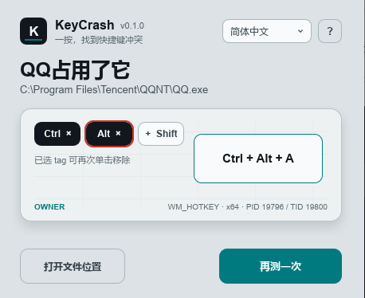

# KeyCrash

**ショートカットが効かない原因を、ひと押しで確認。**

[简体中文](README.md) · [English](README.en.md) · 日本語

KeyCrash は、ショートカットの登録競合を確認し、使用中のアプリの特定を試みるツールです。

**Windows 10 / 11（64 ビット）と macOS** 対応。日本語・中国語・英語を切り替えられます。

## ダウンロードと起動

[Releases](https://github.com/Yuelioi/keycrash/releases) から `keycrash-v<バージョン>-windows-x64.zip` をダウンロードしてください。

すべてのファイルを展開し、`keycrash.exe` を起動してください。同じ場所にあるほかのファイルと `owner-x86` フォルダーも必要です。

M シリーズの Mac は `macos-arm64.zip`、Intel Mac は `macos-x86_64.zip` を選び、展開して `KeyCrash.app` を起動します。Mac 版は ad-hoc 署名で、公証は未実施です。

## 使い方

初期状態は**通常モード**です。次の手順で登録の競合を確認します。

1. 必要な **Ctrl / Alt / Shift / Win** を選びます。もう一度クリックすると解除でき、すべて未選択でも使えます。
2. 検出を開始し、KeyCrash のウィンドウ内で対象のキーだけを押します。例：`Ctrl + Shift + K` なら、Ctrl と Shift を選んでから K を押します。
3. 結果を確認します。登録の競合があれば **「特定」** を選びます。アプリが見つかると、ファイルの場所を開けます。

キーの入力待ちは **キャンセル** をクリックして中止できます。**Esc** も検査対象のキーとして入力できます。右上で言語を切り替え、**?** で使い方を確認できます。

Windows と macOS の**プロモード**では `Ctrl+C+C`、連続キー、修飾キーの2回押しを手動で編集できます。「キーを入力」をクリックし、このウィンドウでキーを1つ押して選択します。動作を選び「追加」をクリックしてください。一覧からの選択も可能で、待機の場合は時間を指定します。キー選択で自動追加やテスト送信は行わず、別のウィンドウに移ると中止します。システムや他のアプリが取得するキーは一覧から選べます。追加・削除・並べ替えができます。`Ctrl+C+C` の例：Ctrl 押下 → C を押して離す → 100 ms 待機 → C を押して離す → Ctrl 解放。最大32ステップ・合計5秒で、押下には対応する解放が必要です。

送信開始時にシーケンスをローカルに保存し、履歴は直近2件まで保持します。同じシーケンスは先頭に移動します。履歴をクリックして読み込み、横の `×` で削除できます。「消去」は編集中の内容だけを消去します。履歴は再起動後も残りますが、送信記録とアプリの応答は保存しません。

対象アプリを起動し、ショートカットを有効にしてテストします。グローバルキーは KeyCrash の画面でも動作します。アプリ内の操作は3秒のカウント中に対象へ切り替えてください。選んだ入力と元の操作が実行されます。テスト中は他のキーを押さないでください。取消時は後続を止め、このテストが保持するキーを解放します。内容はメモリ内だけに保持し、グローバルなキー記録は行いません。

編集・送信・応答を分けて表示します。送信欄は Windows が受け付けた入力で、対象の実行完了の証明ではありません。応答なしでも未使用とは判断できません。通常の熱鍵メッセージは受信した組み合わせを表示し、`GdHotkeys.dll` を使う GoldenDict は通知・スロット・受信プロセスを表示します。検証済みの公式 GoldenDict 1.5.1 x64/x86 DLL では、通知を取り出した時点の設定とテスト入力を比較します。未知のコード、設定変更、不完全な記録、時刻の不確実性がある場合は未確認です。一致は送信元の認証、動作完了や独占を保証しません。

Windows では通常権限で監視します。「管理者権限で監視」は UAC で応答監視だけを昇格し、入力の送信権限は変えません。上位権限のウィンドウへの送信は失敗する場合があります。UAC 拒否時は開始せず、保護プロセスの検出も保証しません。Mac のプロモードも編集・カウントダウン・テストに対応し、アクセシビリティの許可が必要です。独立プロセスからネイティブの物理キーコードを送信します。応答は本テストの Carbon システム熱鍵通知のみで、GoldenDict の連続キー全体や任意のアプリ内操作は帰属しません。

## ご利用にあたって

通常の検出では、ショートカット自体は実行しません。**使用中のアプリを特定するときは、元の操作が実行される場合があります。** Windows では必要に応じて管理者権限を求めます。

Mac では ⌃ Control / ⌥ Option / ⇧ Shift / ⌘ Command を使います。初回はシステム設定で KeyCrash のアクセシビリティを許可してください。検査後に「特定」、または「グローバル監視を調べる」を選び、調べるアプリを指定します。確認中は選択したアプリのほかのショートカットやキーの割り当てが一時停止する場合があり、終了またはキャンセル後に復元されます。

キー項目は Windows が146、Mac が125。記号・独立テンキー・左右の修飾キー・一般的なメディアキーを含みます。Windows はロック・Pause/Break・ブラウザー・IME、Mac はF1～F20とJIS/ISOキーも含みます。表記は米国配列の位置で、実際の文字は現在の配列に従います。ロックキーは状態を変更します。Fn/Globeや機器固有キーは対象外です。
