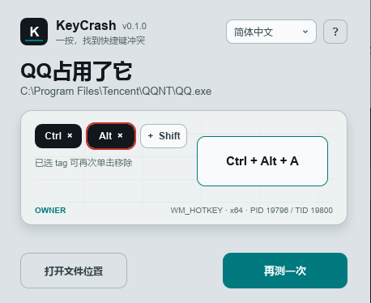

# KeyCrash

**一按，找到快捷键冲突。**

简体中文 · [English](README.en.md) · [日本語](README.ja.md)

快捷键突然没反应？KeyCrash 帮你检查组合键是否存在注册冲突，并尝试找出占用它的软件。

适用于 **Windows 10 / 11（64 位）和 macOS**；支持中文、英文和日文。

## 下载与运行

在 [Releases](https://github.com/Yuelioi/keycrash/releases) 下载 `keycrash-v<版本号>-windows-x64.zip`。

完整解压后运行 `keycrash.exe`。请保留同目录的其他文件和 `owner-x86` 文件夹，不要只复制主程序。

Mac mini M4 / M 系列下载 `macos-arm64.zip`，Intel Mac 下载 `macos-x86_64.zip`，解压运行 `KeyCrash.app`。Mac 包采用 ad-hoc 签名，尚未公证。

## 怎么用

默认使用**普通模式**，按以下步骤检查注册冲突。

1. 选择需要的 **Ctrl / Alt / Shift / Win**；再次点击可取消，也可以都不选。
2. 点击 **开始检测**，在 KeyCrash 窗口里只按目标键。例如检查 `Ctrl + Shift + K`，先选 Ctrl 和 Shift，再按 K。
3. 查看结果。如果发现注册冲突，点击 **定位占用软件**；找到后可打开它的文件位置。

点击 **取消** 可停止等待按键；**Esc** 也可作为目标键检测。右上角可以切换语言，点击 **?** 查看说明。

Windows 和 macOS 的**专业模式**可手动编排 `Ctrl+C+C`、多段组合和修饰键双击。点“按键选取”后，在本窗口按一个键即可填入；再选择点按、按下或松开，点击“添加”。也可从列表选键，等待步骤直接填写时长。选取只填入键名，不自动添加步骤或发送测试输入；切走窗口会取消，系统或其他软件截获的键可从列表选择。可增删步骤、调整顺序。`Ctrl+C+C` 示例为：按下 Ctrl → 点按 C → 等待 100 ms → 点按 C → 松开 Ctrl。最多 32 步、总时长 5 秒，按下和松开需要配对。

开始发送测试时，序列自动保存到本机历史，最多保留最近两条，重复序列移到最前。点击历史可载入，旁边的 `×` 可删除；“清空”仅清除当前编排。重新启动后保留历史，不保存发送记录和软件响应。

先运行目标软件并启用它的快捷键，再点击**测试序列**。全局快捷键可停留在 KeyCrash；应用内快捷键请在 3 秒倒计时内切到目标软件；所选输入和原操作会执行。测试时避免同时按其他键。取消会停止后续步骤，并松开本次按住的键。序列只保存在内存，不需要全局键盘录制。

“编排／发送记录／软件响应”分别显示目标步骤、Windows 接受的发送事件和支持范围内的软件响应。发送成功不保证目标已执行；没有响应也不代表序列可用。普通热键响应显示收到的组合；使用 `GdHotkeys.dll` 的 GoldenDict 可提供通知、槽位和接收进程。已核验的 GoldenDict 1.5.1 官方 x64/x86 DLL 还可读取取消息时的活动绑定，与本次测试输入比较；未知代码、变化或不完整记录、时序不确定时保持未确认。相符不证明消息来源、动作完成或独占。

Windows 默认以普通权限监听。勾选“以管理员权限监听”后开始会请求 Windows UAC，仅提升响应监听权限，不提升输入发送权限；向更高权限窗口发送可能失败。取消授权不开始测试，不保证覆盖受保护进程。Mac 专业模式也支持同样的编排、倒计时和主动测试，需要辅助功能权限；使用原生物理键码与独立执行进程，发送记录表示已提交事件。Mac 响应目前仅覆盖带本次测试标记的 Carbon 系统热键通知，不提供 GoldenDict 连续序列关联或任意应用内功能归因。

Windows 目录包含 146 项，补齐常见标点、小键盘（含独立 Enter）、锁定键、Pause/Break、媒体、浏览器及 IME 键；Mac 目录有 125 项，包含左右修饰键、F1–F20、小键盘、JIS/ISO 位置和常用媒体/亮度键。目录使用美式键位标注，实际字符按当前布局发送；锁定键会改变状态。Fn/Globe 与设备专用键不在目录内，媒体键可发送不等于可定位其系统处理进程。Windows 的 F12 等系统保留规则仍生效。

## 使用前了解

普通检测不会触发完整快捷键；**定位占用软件可能触发快捷键原本的操作**，Windows 必要时会请求管理员权限。

Mac 使用 ⌃ Control / ⌥ Option / ⇧ Shift / ⌘ Command。首次定位时，请在系统设置中允许 KeyCrash 的辅助功能权限。检测后可点击“定位占用软件”，也可点“检查全局监听”并选择参与检查的软件。全局监听检查期间，所选软件的其他快捷键或按键重映射可能短暂停止；检查结束或取消后自动恢复。
