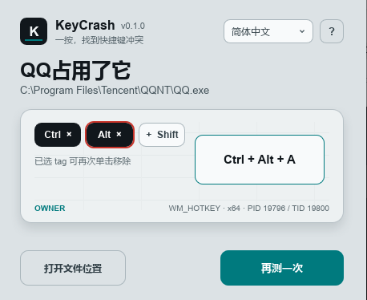

# KeyCrash

**一按，找到快捷键冲突。**

简体中文 · [English](README.en.md) · [日本語](README.ja.md)

快捷键突然没反应？KeyCrash 帮你检查组合键是否存在注册冲突，并尝试找出占用它的软件。

适用于 **Windows 10 / 11（64 位）和 macOS**；支持中文、英文和日文。

v0.2.0 已撤回。v0.2.2 修复 Mac 系统快捷键命中后无法继续定位，以及首次授权后必须重启的问题；使用与验证范围见 [macOS 说明](docs/MACOS.md)。

## 下载与运行

在 [Releases](https://github.com/Yuelioi/keycrash/releases) 下载 `keycrash-v<版本号>-windows-x64.zip`。

完整解压后运行 `keycrash.exe`。请保留同目录的其他文件和 `owner-x86` 文件夹，不要只复制主程序。

Mac mini M4 / M 系列下载 `macos-arm64.zip`，Intel Mac 下载 `macos-x86_64.zip`，解压运行 `KeyCrash.app`。Mac 包采用 ad-hoc 签名，尚未公证。

## 怎么用

1. 选择需要的 **Ctrl / Alt / Shift / Win**；再次点击可取消，也可以都不选。
2. 点击 **开始检测**，在 KeyCrash 窗口里只按目标键。例如检查 `Ctrl + Shift + K`，先选 Ctrl 和 Shift，再按 K。
3. 查看结果。如果发现注册冲突，点击 **定位占用软件**；找到后可打开它的文件位置。

按 **Esc** 可取消等待按键。右上角可以切换语言，点击 **?** 查看说明。

## 使用前了解

普通检测不会触发完整快捷键；**定位占用软件可能触发快捷键原本的操作**，Windows 必要时会请求管理员权限。“未发现注册冲突”不代表没有软件监听；键盘 Hook 等监听方式不在检测范围内。Windows 的 F12 属于系统保留键，会单独提示。其他软件的临时注册只要尚未释放，也会被视为占用。

Mac 使用 ⌃ Control / ⌥ Option / ⇧ Shift / ⌘ Command。检测后可继续点“定位占用软件”，首次定位需在系统设置中允许 KeyCrash 的辅助功能权限。共享注册可能显示“可临时注册”，仍可继续定位。没有匹配接收事件时不会猜测占用者；应用内快捷键和任意键盘监听不在此范围。
